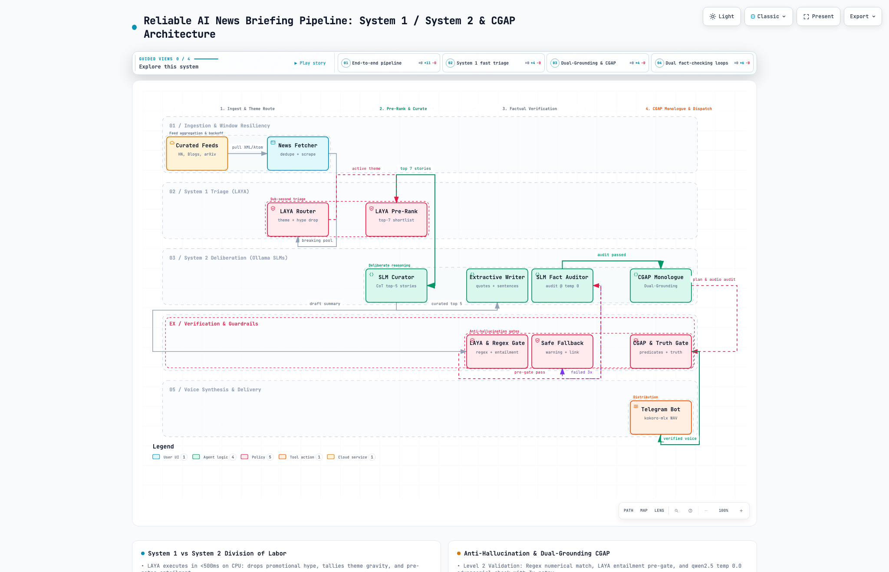

# AI News Daily Voice Briefing Pipeline 🎙️

An automated, 100% local daily AI news briefing pipeline. Uses a **System 1 (LAYA) / System 2 (Ollama)** cognitive architecture for dynamic theme routing, semantic pre-ranking, and multi-layer anti-hallucination verification, synthesizes natural podcast audio locally (`kokoro-mlx` on Apple Silicon Metal), and dispatches formatted summaries and voice briefings directly to Telegram.

---

## 💡 Why Did I Build This?

Beyond building a bespoke, privacy-first news curator, my primary goal was to master the practical engineering challenges of local agentic AI pipelines on consumer hardware.

Key lessons learned:

1. **Immediate Per-Item Validation**: Never wait for a post-hoc batch check. Catch hallucinations early using deterministic fast-fail gates (regex for entities and numbers), strict **Pydantic** schemas, and inline correction-hint retry loops.
2. **The Nuances of Small Language Models ($\le 4\text{B}$)**: Small models struggle with complex negative constraints ("do not include..."). Shorter prompts with positive constraints, few-shot grounding, and extractive quote anchoring yield far higher factual accuracy.
3. **System 1 / System 2 Cognitive Architecture**: Using a fast, lightweight model (LAYA) for sub-second story pre-ranking, hype filtering, and semantic entailment pre-gating cut expensive Ollama generation passes and total runtime by over 50%.
4. **Multi-Layer Evaluation Harness**: Moving beyond "vibe checks" by implementing an enterprise-grade evaluation pipeline: structural regex verification, 1–5 HHH (Helpful, Honest, Harmless) rubrics, ALTK consistency-gap metrics ($\text{Pass}^K$ vs $\text{Mean@K}$), and regression testing against a curated 30-item golden benchmark dataset.
5. **Local Voice Synthesis**: Generating high-fidelity podcast monologues locally using `kokoro-mlx` on Apple Silicon Metal, along with spoken monologue sanitization (stripping markdown syntax and bare URLs before synthesis).
6. **Automated Telegram Delivery**: Packaging the pipeline end-to-end to dispatch daily markdown briefings and audio notes directly via the Telegram Bot API.
7. **Empirical Model Benchmarking & Continuous Quality Flywheel**: Public LLM leaderboards fail to predict how small models perform on bespoke agentic pipelines. Building a dedicated offline evaluation suite (`eval/`) with role-specialized benchmarks (Summarization, Curation, Scriptwriting, Auditing), TTFT/throughput profiling, offline LLM-as-a-judge scoring, and a persistent telemetrics dashboard (`quality.db`) proved vital for matching each sub-4B model to its ideal pipeline role within an 8 GB unified memory budget.
8. **Capability-Grounded Agentic Planning (CGAP)**: Unconstrained script generation from small models ($\le 4\text{B}$) frequently leads to dropped stories, shuffled narratives, and ungrounded entity claims. Implementing the CGAP framework ([Shrestha et al., 2026, WashU - arXiv:2610.41040](https://arxiv.org/abs/2610.41040)) compiles verified Level 2 summaries into atomic ground predicates (`StoryFactPredicate`) and enforces a symbolic execution plan with deterministic pre-gates before TTS synthesis, mathematically guaranteeing 100% story coverage and sequence adherence.

---

## 💻 Command Line Usage & Options

### CLI Usage

```text
usage: uv run python src/generate_news_digest.py [-h] [--config CONFIG] [--dry-run] [--skip-tts]
                                                 [--all-themes] [--theme THEME] [--force] [--clear-history]

AI News Daily Voice Briefing Pipeline

options:
  -h, --help        show this help message and exit
  --config CONFIG   Path to configuration TOML file (default: config.toml)
  --dry-run         Fetch and generate script only; skip TTS synthesis and Telegram dispatch
  --skip-tts        Skip audio synthesis and dispatch only the markdown text digest to Telegram
  --all-themes      Generate full digest for all 4 themes in dry-run mode (saved to output/YYYY-MM-DD_all_themes.md)
  --theme THEME     Specify theme key, 'auto' (LAYA story-driven dynamic routing), or 'random' (default: auto)
  --force           Force execution even on weekends
  --clear-history   Clear the briefed story history database and exit
```

### Testing & Quality Verification

Run the fast-path test suite (102 unit & regression tests in $< 4\text{s}$ with decoupled mock providers):
```bash
uv run pytest
```

Execute the Spec Guardian bi-directional traceability audit across all 9 formal EARS specifications:
```bash
uv run python ~/.gemini/config/skills/spec-driven-development/scripts/guardian.py audit --strict
```

Print the detailed Multi-Layer Evaluation & Reliability Report (Structural Regex, HHH Guardrails, 1–5 Rubrics, and ALTK Consistency Gap tables):
```bash
uv run python src/model_eval/evaluator.py
# Or view with pytest stdout capture disabled:
uv run pytest -s tests/test_golden_eval.py
```

Run heavy, live neural model integration tests (loads live LAYA / Ollama models into memory):
```bash
uv run pytest -m heavy
```

Compare candidate Ollama models across all 4 pipeline roles (Summarization, Curation, Scriptwriting, Adversarial Audit):
```bash
uv run python src/model_eval/model_comparator.py --task all
```

### 📊 Telemetrics & Quality Web Dashboard

Launch the interactive telemetrics webpage server to monitor pipeline execution telemetry, memory footprints, fact-checking pass rates, and submit human quality reviews:

```bash
uv run python src/quality_dashboard/serve_dashboard.py
```

Once launched, open your browser at:  
👉 **`http://127.0.0.1:8765/`**

**Options**:
* `--port PORT`: Specify custom port (default: `8765`)
* `--host HOST`: Specify host IP address (default: `127.0.0.1`)

*Note: The server automatically initializes `eval/quality.db` and backfills telemetry metrics from existing briefing files in `output/` if starting fresh.*

---

## 🏛️ System Architecture

The pipeline is built as a modular, local-first, factual-guaranteed system designed to execute with zero paid cloud API dependencies on local hardware (Apple Silicon / Metal), augmented with a **System 1 (LAYA) / System 2 (Ollama)** cognitive architecture and **Capability-Grounded Agentic Planning (CGAP)**.

> 📖 **Full Engineering Guide**: See [docs/RELIABLE_NEWS_PIPELINE.md](docs/RELIABLE_NEWS_PIPELINE.md) for a comprehensive breakdown of each pipeline stage and reliability guarantee.  
> 🗺️ **Interactive Pipeline Diagram**: Open [docs/pipeline_workflow.html](docs/pipeline_workflow.html) in your browser for the full interactive architecture diagram with stage focus views and theme switching.  
> 🧪 **Interactive Testing Diagram**: Open [docs/testing_strategy.html](docs/testing_strategy.html) for the 4-tier testing and evaluation visual architecture.

<p align="center">
  <picture>
    <source media="(prefers-color-scheme: dark)" srcset="docs/pipeline_architecture.dark.png">
    <source media="(prefers-color-scheme: light)" srcset="docs/pipeline_architecture.png">
    
  </picture>
</p>

### Core Architectural Pillars

1. **Hierarchy of Truth & Extractive Anchoring**:
   - Small Language Models ($\le 4\text{B}$) are forced to extract verbatim quotes (`direct_quotes: list[str]`) into a strict Pydantic schema before generating summaries.
   - The spoken podcast monologue is generated and fact-checked strictly against the *already-validated summaries* rather than noisy, uncurated raw RSS feeds.
2. **Deterministic Fast-Fail Pre-Gates**:
   - `validator.py` applies deterministic regex matching for unanchored proper nouns, company names, model names (`detect_unanchored_entities`), and numerical fabrications (`detect_fabrications`) in $< 1\text{ms}$ before executing neural checks.
3. **System 1 / System 2 Specialization & Zero-Cost Privacy**:
   - **System 1 Triage & Entailment**: `convaiinnovations/laya` (sub-second theme routing, hype filtering, candidate pre-ranking, and semantic entailment pre-gating).
   - **Curation & Monologue Scripting**: `phi4-mini:3.8b` (structured logic, ranking, and conversational flow).
   - **Extractive Summarization & Fact Auditing**: `qwen2.5:3b` (adversarial precision and factual verification).
   - **TTS Voice Synthesis**: `kokoro-mlx` running on Apple Silicon Metal acceleration after automatic LLM/LAYA memory offloading.
4. **Structured Typed Outputs**:
   - Strongly-typed Pydantic schemas (`CurationResponse`, `StorySummaryResponse`, `FactCheckResponse`) enforce structured JSON schemas via Ollama's native schema format, eliminating JSON syntax errors.
   - `BriefingOutput` enforces strict, standardized Markdown document structures across all output digests.

---

## ⚡ Key Features

- **100% Local & Private Execution**: Runs entirely on Apple Silicon (8 GB M1 budget) with zero recurring paid API subscriptions.
- **Dynamic Story-Driven Theme Routing**: Uses LAYA System 1 to sample breaking headlines across feeds and route daily briefings to the theme with the strongest signal (with recent-theme cooldown rotation):
  - 🧭 **Practitioner's Radar**: Production deployment patterns, MLOps, inference optimization, and engineering architecture.
  - 🏛️ **Executive Lens**: Strategic moves, industry risks, enterprise shifts, safety, and regulation.
  - 🔨 **Builder's Digest**: Concrete tools, open-source libraries, local AI, and developer tooling.
  - 🔭 **Innovation Scout**: Cross-disciplinary AI breakthroughs in science, biology, robotics, and creative domains.
- **Cross-Day Recurrence Suppression & Source Diversity**:
  - Persistent 7-day SQLite sliding-window filter (`story_history.py`) applies a 75% soft score decay to previously briefed stories and tags major evolving stories with `_🔄 Follow-up_` annotations.
  - Enforces a cap of 2 stories per single RSS source per briefing and applies fuzzy title deduplication (`difflib.SequenceMatcher`).
- **Multi-Layer Evaluation & HHH Guardrails**:
  - **Layer 1 (Regex & Structure)**: Enforces heading link syntax `## [Title](URL)` and detects bare URL leaks.
  - **Layer 2 (HHH Guardrails & 1–5 Rubrics)**: Audits outputs on a 1.0–5.0 scale for **Honest** (zero hallucinated figures), **Helpful** (technical depth), and **Harmless** (objective, hype-free tone).
  - **Layer 3 (LLM-as-a-Judge & Consistency Metrics)**: Runs multi-trial evaluations (`eval_runs=N`) over a 30-item golden benchmark, calculating **Mean@K**, **$\text{Pass@K}$**, **$\text{Pass}^K$**, and **ALTK Consistency Gap**.
- **Local TTS & Telegram Dispatch**: Synthesizes natural 24 kHz spoken audio using `kokoro-mlx` and delivers formatted summaries and WAV audio files via Telegram Bot API (handling 45 MB file splitting automatically).

---

## 📂 Project Structure

```text
AI_news_voice_feed/
├── config.toml                   # Central configuration (themes, RSS sources, LAYA, voice, LLM)
├── pyproject.toml                # Project metadata, dependencies & pytest/ruff config
├── ADR.md                        # Architectural Decision Records (ADR-01 through ADR-15)
├── RELEASE.md                    # Semantic Versioning release changelog
├── AGENTS.md                     # Workspace engineering standards & hardware invariants
├── .env.example                  # Environment template for Telegram & offline eval credentials
├── docs/                         # Architecture guides & interactive HTML workflow diagrams
│   ├── RELIABLE_NEWS_PIPELINE.md # Deep-dive stage-by-stage engineering guide
│   ├── pipeline_workflow.html    # Interactive System 1 / System 2 pipeline visualizer
│   └── testing_strategy.html     # Interactive 4-tier testing & evaluation visualizer
├── eval/                         # Quality tracker DB & benchmark datasets
│   ├── README.md                 # Evaluation subsystem documentation & benchmark guides
│   ├── eval_config.toml          # Model comparator benchmark configuration
│   └── golden_dataset.json       # Multi-role benchmark dataset for model comparison
├── launchd/
│   └── com.aibriefing.daily.plist # macOS LaunchAgent daily schedule configuration
├── specs/                        # Formal EARS specifications & Spec Guardian traceability
│   ├── system_aims.md            # AIM-001..004 System Aims
│   ├── themes.md                 # THEME-001..005 Thematic Architecture & Routing
│   ├── validator.md              # VALID-001..003 Deterministic Validation
│   ├── summarizer.md             # SUMM-001..004 Extractive Summarization
│   ├── cgap_planner.md           # CGAP-001..004 Capability-Grounded Agentic Planning
│   ├── audio_monologue.md        # AUDIO-001..004 Monologue & Speech Synthesis
│   ├── quality_tracker.md        # TRACK-001..003 SQLite Telemetry & HITL Promotion
│   ├── serve_dashboard.md        # DASH-001..003 Dashboard Server & REST API
│   ├── model_comparator.md       # COMPARE-001..003 Multi-Role Benchmark & Reporting
│   └── traceability.json         # Automated bi-directional traceability graph
├── src/
│   ├── generate_news_digest.py   # Main CLI entrypoint & phase orchestrator
│   ├── news_fetcher.py           # Concurrent RSS aggregation, scraping, scoring & filtering
│   ├── laya_decision.py          # LAYA System 1 router, pre-ranker, hype filter & entailment gate
│   ├── cgap_planner.py           # CGAP capability compilation, symbolic planning & grounding gate
│   ├── briefing_generator.py     # LLM story curation, markdown digest & monologue generator
│   ├── model_provider.py         # Centralized LLM provider factory & VRAM manager
│   ├── story.py                  # Structured Story and BriefingOutput data contracts
│   ├── story_history.py          # Persistent sliding-window recurrence & decay manager
│   ├── validator.py              # Anti-hallucination validation & deterministic entity/number gates
│   ├── telemetry.py              # Stage latency & RSS memory profiler
│   ├── notifier.py               # Local TTS synthesis (kokoro-mlx) & Telegram dispatch
│   ├── model_eval/               # Model evaluation & benchmarking package
│   │   ├── __init__.py           # Package exports
│   │   ├── evaluator.py          # 3-layer evaluation harness (Regex, HHH, Pass^K / Consistency Gap)
│   │   ├── model_comparator.py   # Multi-role LLM benchmark harness & role dispatcher
│   │   ├── metrics.py            # ROUGE-L, keyword overlap, length, and hallucination metrics
│   │   ├── judges.py             # LLM-as-a-judge and heuristic scoring
│   │   └── save_html.py          # Chart.js HTML report generator
│   └── quality_dashboard/        # Telemetrics & human review dashboard package
│       ├── __init__.py           # Package exports
│       ├── quality_tracker.py    # SQLite telemetry, quality scoring & HITL benchmark promotion
│       ├── serve_dashboard.py    # Web server & REST API for telemetrics dashboard
│       └── quality_dashboard.html # Interactive telemetrics single-page web interface
└── tests/                        # 102 fast-path unit tests + 30-case golden benchmark suite
```

---

## 🚀 Setup & Installation

### 1. Prerequisites
- **uv**: Python package and environment manager. Install dependencies:
  ```bash
  uv sync
  ```
- **Ollama**: Running locally with your configured small language models:
  ```bash
  ollama pull phi4-mini:3.8b
  ollama pull qwen2.5:3b
  ```

### 2. Configure Environment Secrets
Copy `.env.example` to `.env` and fill in your Telegram credentials:
```bash
cp .env.example .env
```
Edit `.env`:
```env
TELEGRAM_BOT_TOKEN="your_telegram_bot_token_here"
TELEGRAM_CHAT_ID="your_telegram_chat_id_here"
```

### 3. Configuration (`config.toml`)
Customize themes, RSS feed URLs, specialized model tags, and schedule settings in [config.toml](config.toml):
- `schedule.weekdays_only`: Restricts automatic runs to Monday–Friday (default: `true`).
- `feeds.max_stories`: Number of top stories selected per briefing (default: `5`).
- `feeds.candidate_pool_size`: Size of candidate pool collected before curation (default: `15`).
- `feeds.max_age_hours`: Maximum publication age cutoff in hours (default: `96.0` to bridge weekends).
- `feeds.request_timeout`: Network request timeout in seconds per feed query (default: `25`).
- `feeds.max_retries`: Retry attempts with exponential backoff on transient HTTP 502/504 errors (default: `3`).
- `tts.voice`: Kokoro TTS voice preset (default: `"am_michael"` or `"bm_george"`).
- `llm.curation_model`: Model for theme-based story selection and CoT justification (default: `"phi4-mini:3.8b"`).
- `llm.summary_model`: Model for extractive anchoring and factual distillation (default: `"qwen2.5:3b"`).
- `llm.script_model`: Model for spoken conversational podcast monologue generation (default: `"phi4-mini:3.8b"`).
- `testing.audit_model`: Adversarial model for anti-hallucination fact checking (default: `"qwen2.5:3b"`).

---

## 💻 CLI Commands & Pipeline Execution

```bash
# 1. Live Daily Briefing (LAYA dynamic theme routing + TTS + Telegram)
uv run python src/generate_news_digest.py

# 2. Dry-Run Generation (Text briefing + monologue without audio synthesis or Telegram)
uv run python src/generate_news_digest.py --dry-run

# 3. Source Pool Health Audit (Concurrently pings all 22 RSS feeds across all 4 themes)
uv run python src/generate_news_digest.py --check-sources

# 4. Explicit Theme Selection (practitioner_radar | executive_lens | builders_digest | innovation_scout)
uv run python src/generate_news_digest.py --theme practitioner_radar --dry-run

# 5. All-Themes Batch Catch-Up Mode (Generates summaries across all 4 themes)
uv run python src/generate_news_digest.py --all-themes

# 6. Multi-Model Benchmark Harness
uv run python src/model_eval/model_comparator.py

# 7. Local Quality Dashboard & HITL Review Web Interface (http://localhost:8080)
uv run python src/quality_dashboard/serve_dashboard.py
```

---

## ⏰ Scheduled Automation (`launchd`)

To run the briefing automatically every day on macOS:

1. Update `/Users/YOUR_USERNAME` and the repository path in `launchd/com.aibriefing.daily.plist` to match your local machine.
2. Copy the plist to LaunchAgents:
   ```bash
   cp launchd/com.aibriefing.daily.plist ~/Library/LaunchAgents/
   ```
3. Load and register the service:
   ```bash
   launchctl load -w ~/Library/LaunchAgents/com.aibriefing.daily.plist
   ```
4. Test trigger immediately:
   ```bash
   launchctl start com.aibriefing.daily
   ```
