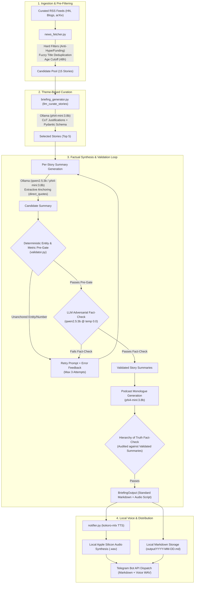

# AI News Daily Voice Briefing Pipeline 🎙️

An automated, local daily AI news briefing pipeline. Uses theme-driven story selection across curated RSS feeds, generates tailored briefing digests and spoken monologues using local LLMs (via Ollama), synthesizes high-quality audio locally (`kokoro-mlx`), and dispatches formatted summaries and audio briefings directly to Telegram.

---

## 💻 Command Line Usage & Options

### CLI Usage

```text
usage: uv run python src/generate_news_digest.py [-h] [--config CONFIG] [--dry-run] [--skip-tts] [--all-themes] [--force]

AI News Daily Voice Briefing Pipeline

options:
  -h, --help       show this help message and exit
  -c, --config     Path to configuration file (default: config.toml)
  --dry-run        Fetch and generate script only; skip TTS synthesis and Telegram dispatch
  --skip-tts       Skip audio synthesis and dispatch only the markdown text digest to Telegram
  --all-themes     Generate a full digest for all 4 themes in dry-run mode (saved to output/YYYY-MM-DD_all_themes.md)
  --force          Force execution even on weekends
```

### Testing & Quality Verification

Run the full evaluation test suite (Golden Dataset, HHH Guardrails, 1–5 Rubrics, and Regex rules):
```bash
uv run python -m pytest tests/ -v
```

*Note: Multi-layer evaluation checks Structural Regex (`## [Title](URL)`), HHH Guardrails (Helpful, Honest, Harmless), 1–5 Rubric Scoring, and multi-run Pass@K / Pass Rate % metrics.*

---

## 🏛️ System Architecture

The pipeline is built as a modular, local-first, factual-guaranteed system designed to execute with zero paid cloud API dependencies on local hardware (Apple Silicon / Metal).



### Core Architectural Pillars

1. **Hierarchy of Truth & Extractive Anchoring**:
   - Small Language Models ($\le 4\text{B}$) are forced to extract verbatim quotes (`direct_quotes: list[str]`) into a strict Pydantic schema before generating summaries.
   - The spoken podcast monologue is generated and fact-checked strictly against the *already-validated summaries* rather than noisy, uncurated raw RSS feeds.
2. **Deterministic Fast-Fail Pre-Gates**:
   - `validator.py` applies deterministic regex matching for unanchored proper nouns, company names, model names (`detect_unanchored_entities`), and numerical fabrications (`detect_fabrications`) in $< 1\text{ms}$ before executing LLM self-checks.
3. **Model Specialization & Zero-Cost Privacy**:
   - **Curation & Monologue Scripting**: `phi4-mini:3.8b` (structured logic, ranking, and conversational flow).
   - **Extractive Summarization & Fact Auditing**: `qwen2.5:3b` (adversarial precision and factual verification).
   - **TTS Voice Synthesis**: `kokoro-mlx` running on Apple Silicon Metal acceleration.
4. **Structured Typed Outputs**:
   - Strongly-typed Pydantic schemas (`CurationResponse`, `StorySummaryResponse`, `FactCheckResponse`) enforce structured JSON schemas via Ollama's native schema format, eliminating JSON syntax errors.
   - `BriefingOutput` enforces strict, standardized Markdown document structures across all output digests.

---

## ⚡ Key Features

- **Local & Private Execution**: Sequential processing requiring zero external paid API subscriptions.
- **Randomized Theme Selection**: Automatically selects one of four engineering lenses daily:
  - 🧭 **Practitioner's Radar**: Production deployment patterns, MLOps, inference optimization, and engineering architecture.
  - 🏛️ **Executive Lens**: Strategic moves, industry risks, enterprise shifts, safety, and regulation.
  - 🔨 **Builder's Digest**: Concrete tools, open-source libraries, local AI, and developer tooling.
  - 🔭 **Innovation Scout**: Cross-disciplinary AI breakthroughs in science, biology, robotics, and creative domains.
- **Source Diversity & Filtering**:
  - Enforces a cap of 2 stories per single RSS source per briefing.
  - Applies fuzzy title deduplication (`difflib.SequenceMatcher`) to prevent repetitive coverage across feeds.
  - Applies negative keyword and quote-post filters to keep content technical and hype-free.
- **Multi-Layer Evaluation & HHH Guardrails**:
  - **Layer 1 (Regex & Structure)**: Enforces heading link syntax `## [Title](URL)` and detects bare URL leaks.
  - **Layer 2 (HHH Guardrails & 1–5 Rubrics)**: Audits outputs on a 1.0–5.0 scale for **Honest** (zero hallucinated figures), **Helpful** (technical depth), and **Harmless** (objective, hype-free tone).
  - **Layer 3 (LLM-as-a-Judge & Multi-Run Metrics)**: Runs multi-trial evaluations (`eval_runs=N`), calculating **Pass Rate %** and **Pass@K** metrics.
- **Local TTS**: Synthesizes natural spoken audio using `kokoro-mlx` with automatic chunking and sample rate controls.
- **Telegram Dispatch**: Delivers formatted summaries and WAV audio files via Telegram Bot API (handles 50MB file splitting automatically).

---

## 📂 Project Structure

```
AI_news_voice_feed/
├── config.toml                   # Central configuration (themes, RSS sources, schedule, voice, LLM)
├── pyproject.toml                # Project metadata & dependencies
├── ADR.md                        # Architectural Decision Record (architecture, decisions & testing)
├── .env.example                  # Environment template for Telegram credentials
├── .gitignore                    # Local storage ignore rules
├── launchd/
│   └── com.aibriefing.daily.plist # macOS LaunchAgent configuration
├── output/                       # Generated audio (.wav) and markdown (.md) briefings
├── src/
│   ├── generate_news_digest.py   # Main CLI entrypoint & orchestrator
│   ├── news_fetcher.py           # RSS aggregation, cleaning, scoring & filtering
│   ├── briefing_generator.py     # LLM story curation, markdown digest & monologue generator
│   ├── story.py                  # Structured Story and BriefingOutput data contracts
│   ├── notifier.py               # Local TTS synthesis & Telegram dispatch
│   ├── validator.py              # Anti-hallucination validation module & deterministic entity gates
│   └── evaluator.py              # Evaluation harness (Regex, HHH Guardrails, LLM-as-a-Judge)
└── tests/                        # Golden dataset, HHH guardrails, and accuracy test suite
```

---

## 🚀 Setup & Installation

### 1. Prerequisites
- **uv**: Python package installer and virtualenv manager.
- **Ollama**: Running locally with your configured models:
  ```bash
  ollama pull phi4-mini:3.8b
  ollama pull qwen2.5:3b
  ```

### 2. Configure Environment Secrets
Copy `.env.example` to `.env` and fill in your Telegram credentials:
```bash
cp .env.example .env
```
Edit `.env`:
```env
TELEGRAM_BOT_TOKEN="YOUR_TELEGRAM_BOT_TOKEN"
TELEGRAM_CHAT_ID="YOUR_TELEGRAM_CHAT_ID"
```

### 3. Configuration (`config.toml`)
Customize themes, RSS feed URLs, specialized model tags, and schedule settings in `config.toml`:
- `schedule.weekdays_only`: Restricts automatic runs to Monday–Friday (default: `true`).
- `feeds.max_stories`: Number of top stories selected per briefing (default: `5`).
- `feeds.candidate_pool_size`: Size of candidate pool collected before LLM curation (default: `15`).
- `llm.curation_model`: Model for theme-based story selection and CoT justification (default: `"phi4-mini:3.8b"`).
- `llm.summary_model`: Model for extractive anchoring and factual distillation (default: `"qwen2.5:3b"`).
- `llm.script_model`: Model for spoken conversational podcast monologue generation (default: `"phi4-mini:3.8b"`).
- `testing.audit_model`: Adversarial model for anti-hallucination fact checking (default: `"qwen2.5:3b"`).

---

## ⏰ Scheduled Automation (`launchd`)

To run the briefing automatically on a schedule:

1. Copy the plist to LaunchAgents:
   ```bash
   cp launchd/com.aibriefing.daily.plist ~/Library/LaunchAgents/
   ```
2. Load and register the service:
   ```bash
   launchctl load -w ~/Library/LaunchAgents/com.aibriefing.daily.plist
   ```
3. Test trigger immediately:
   ```bash
   launchctl start com.aibriefing.daily
   ```
