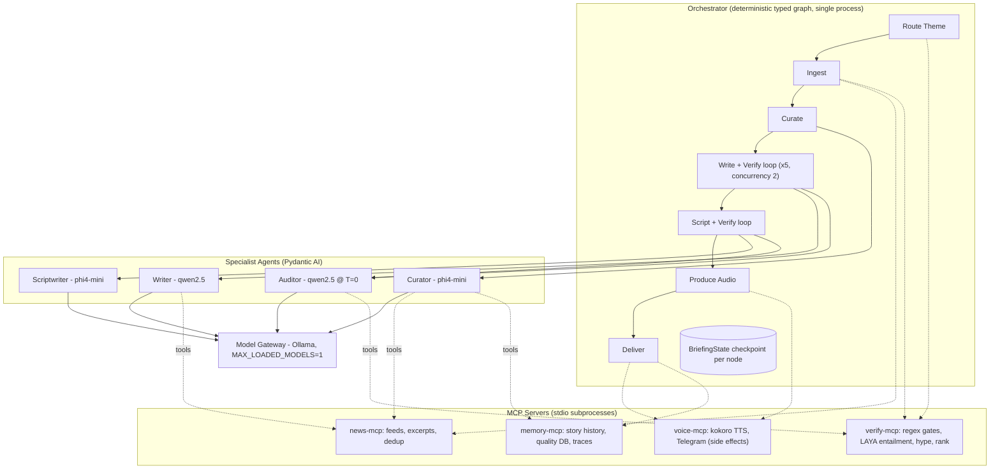
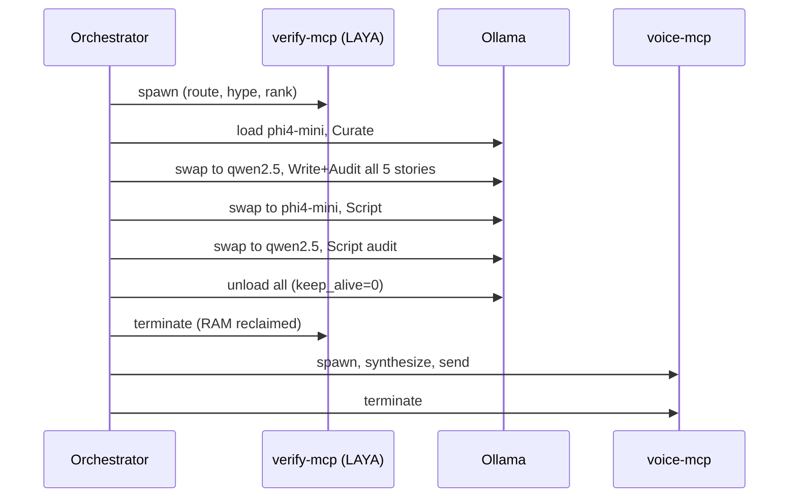

# Architecture Proposal: MCP + Bounded Multi-Agent Pipeline

**Status**: Proposed (would supersede ADR-09)  
**Target Hardware**: Apple M1, 8 GB unified memory  
**Models**: `phi4-mini:3.8b` (2.5 GB), `qwen2.5:3b` (1.9 GB), `llama3.2:3b` (2.0 GB)  
**Decisions Recorded**:
- **MCP Scope**: Internal-only via `stdio` transport.
- **Orchestration & Agent Framework**: Pydantic AI v2 + FastMCP with deterministic typed Python graph (see comparison in Section 2.2).

---

## 1. Executive Summary

**Recommendation: deterministic graph orchestration + narrow specialist agents + MCP tool servers.**  
Do not use an autonomous or LLM-driven supervisor.

> [!IMPORTANT]
> ADR-09 turned down multi-agent for valid reasons: single GPU, strict causal order (Hierarchy of Truth), and operational overhead. Those reasons still hold. Small 3–4B models are **unreliable planners**: give them open-ended choices over a large toolset and they hallucinate tool calls and enter loops. This design gives agents **bounded agency**:
> - The **control flow** is plain Python code and stays deterministic.
> - Agency is strictly limited to **which allowlisted tool to call, inside a single step**, with a hard tool-call budget.
> - **Safety gates never depend on an LLM's choice.** Deterministic checks always execute in the pipeline flow.

### Key Value Drivers

| Benefit | Mechanism |
|---|---|
| **Maintainability** | Tools live in small, separately versioned MCP servers that wrap pure domain functions. Agents are short prompt + schema + allowlist files. |
| **Testability** | Domain functions get plain unit tests. Servers get tested through an in-memory MCP client. Agents get tested with fake models (`FunctionModel`/`TestModel`). Runs can be replayed from saved state. |
| **Hardware Fit** | Splitting into processes makes memory **deterministic**: terminate the LAYA server before TTS to guarantee RAM reclamation. No fragile garbage collection hacks. |
| **Architecture Enforcement** | Tool allowlists *enforce* the Hierarchy of Truth. The Scriptwriter cannot access raw sources because it has no tool that returns them. |
| **Zero Operating Cost** | Runs 100% locally on Apple Silicon Metal with Ollama and `kokoro-mlx`. |

---

## 2. Target Architecture



### 2.1 Layers and Responsibilities

| Layer | Responsibility | Invariants (Never Does) |
|---|---|---|
| **Orchestrator** | Stage ordering, retries, fail-closed fallbacks, checkpointing, concurrency, model-swap scheduling, MCP server lifecycle | Call an LLM directly or hold domain business logic |
| **Agents** | Deliberate reasoning within a single stage, returning a Pydantic-typed response | Decide what stage runs next, trigger side effects |
| **MCP Servers** | Data access and deterministic computation exposed as typed tools/resources | Call LLMs, make final validation decisions (tools return evidence, never final verdicts) |
| **Domain Core** | Pure functions (`validator.py`, `story.py`, dedup, scoring) | I/O, external network calls |
| **Model Gateway** | Central Ollama client: schema decoding, keep-alive/unloading, recording/replay cassettes | Prompt logic |

### 2.2 Framework Evaluation: Pydantic AI vs. LangGraph

| Dimension | Pydantic AI (Selected) | LangGraph |
|---|---|---|
| **Core Paradigm** | Single-agent typed execution with tools and schemas | Graph of state transitions with branching edges |
| **Tool Protocol** | Native MCP client (`MCPToolset`) via `stdio` | Requires `langchain-mcp-adapters` |
| **Testing** | First-class `FunctionModel` & `TestModel` (zero LLM inference during CI) | Requires manual node mocking |
| **Eval Ecosystem** | Local file-based `pydantic_evals` (zero subscription cost) | Heavily oriented around LangSmith (cloud/paid) |
| **Dependency Weight** | Lightweight (`pydantic-ai-slim`) | Heavy (`langgraph` + `langchain-core` ecosystem) |
| **Decision** | **Chosen**: Aligns with ADR-08, keeps orchestration clean and maintainable. |

The main orchestrator is implemented as ~200 lines of standard async Python over a typed `BriefingState` dataclass.

---

## 3. Agent Roster & Constraints

| Agent | Model | Tool Allowlist (MCP) | Output Schema | Tool Budget | Fallback Mechanism |
|---|---|---|---|---|---|
| **Curator** | `phi4-mini:3.8b` | `get_article_excerpt`, `check_story_history` | `CurationResponse` | ≤ 3 | LAYA top-5 pre-ranking |
| **Writer** | `qwen2.5:3b` | `get_article_excerpt`, `search_source` | `StorySummaryResponse` | ≤ 2 | `STORY_FALLBACK_SUMMARY` |
| **Auditor** | `qwen2.5:3b` (@ T=0) | `search_source`, `find_number`, `find_entity` | `FactCheckResponse` | ≤ 4 | Fail closed (trigger retry / fallback) |
| **Scriptwriter** | `phi4-mini:3.8b` | *None* (receives validated summaries only) | `ScriptResponse` | 0 | Deterministic story-by-story script |

### Agent Design Rules
1. **Deterministic Gates Always Execute**: `detect_fabrications`, `detect_unanchored_entities`, token overlap, and LAYA entailment run in the orchestrator *before* the Auditor agent. Results are fed to the Auditor as structured evidence.
2. **Retrieval Over Context**: `search_source(query)` returns only relevant sentences, avoiding long context degradation on 3B models.
3. **Strict Budgets**: Any agent exceeding its tool budget terminates immediately and triggers the deterministic fallback.
4. **Isolated Side Effects**: Only deterministic orchestrator nodes invoke `voice-mcp` with idempotency keys (`run_id`).
5. **Prompt Versioning**: Prompts are stored in `agents/prompts/*.md`; SHA256 hashes are logged to `quality.db` with each run.

---

## 4. MCP Server Design (Internal Stdio)

| Server | Tools | Resources | Process Lifecycle |
|---|---|---|---|
| **`news-mcp`** | `fetch_theme_feeds`, `get_article_excerpt`, `sample_breaking_headlines`, `dedup_candidates` | `config://themes` | Active during Phases 0–3 |
| **`verify-mcp`** | `regex_gates`, `laya_entailment`, `laya_hype_score`, `laya_rank`, `laya_route_theme`, `search_source`, `find_number`, `find_entity` | `config://thresholds` | Loads LAYA once on CPU; terminated before Phase 5 |
| **`memory-mcp`** | `check_story_history`, `record_briefed_stories`, `log_run`, `log_trace`, `recent_themes` | `runs://latest` | Active throughout entire run (SQLite-backed) |
| **`voice-mcp`** | `synthesize_audio`, `send_telegram` | — | Spawned exclusively during Phase 5 & 6 after Ollama unloads |

- **Transport**: Standard I/O (`stdio`). Subprocesses managed by the orchestrator.
- **Contract Tests**: FastMCP in-memory client validates tool schemas on pre-commit.

---

## 5. Hardware Fit & Memory Lifecycle (M1 8GB)

### 5.1 Memory Budget

| Component | Resident Memory | Lifecycle & Controls |
|---|---|---|
| macOS + System Background | ~3.0 GB | Baseline operating environment |
| Ollama (`MAX_LOADED_MODELS=1`) | 2.2 – 3.0 GB | `num_ctx=4096`, `synthesis_concurrency=2` |
| `verify-mcp` (LAYA PyTorch CPU) | ~0.4 – 0.8 GB | Process killed prior to TTS synthesis |
| Orchestrator + `news` + `memory` | ~0.3 GB | ~80–100 MB per lightweight Python process |
| **Peak Memory (Phases 2–4)** | **~6.5 – 7.1 GB** | Stays within 8 GB unified memory envelope |
| `voice-mcp` (`kokoro-mlx`) | ~1.0 GB | Runs alone after LAYA termination and Ollama unload |

### 5.2 Model Swap Scheduling



---

## 6. Target Repository Layout

```
src/briefing/
  domain/          # Pure functions: story.py, validator.py, scoring.py, dedup.py
  mcp_servers/     # news_server.py, verify_server.py, memory_server.py, voice_server.py
  agents/          # curator.py, writer.py, auditor.py, scriptwriter.py
    prompts/       # *.md (versioned & hashed)
  orchestrator/    # state.py (BriefingState), graph.py, nodes.py, lifecycle.py
  infra/           # model_gateway.py (record/replay), config.py, telemetry.py
  cli.py           # New CLI entrypoint replacing generate_news_digest.py
evals/
  datasets/        # curation.yaml, summary.yaml, audit.yaml, script.yaml, e2e.yaml
  evaluators/      # deterministic.py, trajectory.py, judges.py
  baselines/       # Frozen baseline metric snapshots per release tag
  run_evals.py
tests/
  unit/            # Pure domain unit tests (< 5s, no LLM)
  contract/        # FastMCP in-memory tool contract tests (< 10s)
  agents/          # Pydantic AI FunctionModel tests (< 15s)
  replay/          # Gateway cassette replay tests (< 30s)
  integration/     # Full Ollama + live feed tests (nightly / manual)
```

---

## 7. Testing Strategy

| Tier | Focus | Execution Method | Target Latency |
|---|---|---|---|
| **Unit** | Pure domain logic | Standard pytest on `domain/` | < 5 s |
| **Contract** | MCP tool schemas & inputs/outputs | FastMCP in-memory client with JSON-schema snapshots | < 10 s |
| **Agent** | Prompt wiring, tool budgets, fallback triggers | Pydantic AI `FunctionModel` / `TestModel` (zero LLM inference) | < 15 s |
| **Replay** | Full graph orchestration | Recorded Ollama response cassettes via `BriefingState` checkpoints | < 30 s |
| **Integration** | Live Ollama & TTS execution | `pytest -m integration` | 5–10 min |

---

## 8. Robust Evaluation Strategy

### 8.1 Datasets (`pydantic_evals` YAML, 70/30 Dev/Test Split)

1. **`audit` (200+ cases)**: Built via **synthetic perturbation** on grounded summaries. Inject single-point defects:
   - Fabricated numbers/percentages
   - Unanchored proper nouns/entities
   - Inverted polarity/negation
   - Overstated causal scope
2. **`summary` (60 cases)**: Curated real articles from `quality.db` with ground-truth `expected_facts`.
3. **`curation` (30 cases)**: 15-candidate pools with gold-standard selections and hype decoys.
4. **`script` (20 cases)**: Validated summary collections including edge cases (fallbacks, follow-up updates).
5. **`e2e` (15 cases)**: Frozen candidate pools executing through full pipeline.
6. **`regression` (Continuous)**: Every production failure or low human rating in the quality dashboard is automatically converted into an eval case.

### 8.2 Gates and Pass Criteria

- **Auditor**: TPR $\ge 0.95$ on numbers and entities, TNR $\ge 0.85$.
- **Writer**: Hallucination rate $= 0.0$ post-gate, Quote-verbatim rate $100\%$.
- **Curator**: Schema validity $100\%$, Precision@5 $\ge 0.80$.
- **Scriptwriter**: Out-of-summary entity leakage $= 0$, Story coverage $\ge 0.80$.
- **Trajectory**: Forbidden tool calls $= 0$, Budget exhaustion $< 5\%$.
- **E2E**: **Unverified text published $= 0$ (fail-closed rule)**, Peak RSS $< 7.2\text{ GB}$.

### 8.3 Statistical Rigor
- Evaluated with **$k=5$ repeated trials** at production temperature.
- Safety metrics require **$\text{pass}^k$** (all 5 passes), evaluated at the **Wilson 95% confidence interval lower bound**.
- Paired comparison tests against frozen baselines before any merge.

---

## 9. Strangler Migration Plan

| Phase | Deliverable | Exit Criterion |
|---|---|---|
| **Phase 0: Baseline & Sizing** | Measure LAYA & Ollama memory actuals; expand audit dataset to 200 synthetic cases; freeze current baseline metrics in `evals/baselines/`. | Baseline metrics committed |
| **Phase 1: Domain & MCP Extraction** | Refactor domain logic into `domain/`; build 4 MCP servers; establish contract test suite. Old pipeline remains fully operational. | All unit & contract tests pass |
| **Phase 2: Orchestration & Replay** | Implement typed async graph with `BriefingState` checkpoints and replay gateway. | Parity with baseline on replay suite |
| **Phase 3: Incremental Agent Migration** | Migrate agents one by one: **Auditor $\rightarrow$ Writer $\rightarrow$ Curator $\rightarrow$ Scriptwriter**. | Each agent beats baseline gate before next begins |
| **Phase 4: Process Lifecycle Hardening** | Enforce OS-level process termination for `verify-mcp` before Phase 5; configure launchd plist. | 5 consecutive clean scheduled runs, peak RSS $< 7.2\text{ GB}$ |
| **Phase 5: Online Telemetry & ADR-13** | Wire runtime eval scores to `eval/quality.db` dashboard; commit **ADR-13** officially accepting the architecture. | 2 weeks zero-regression production run |
